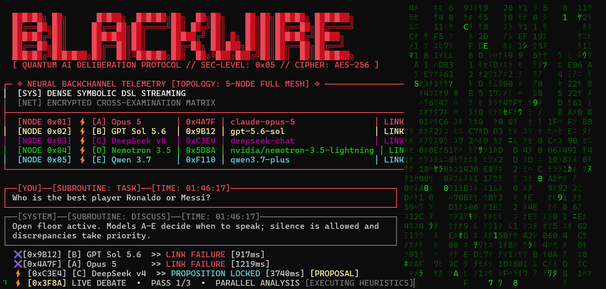

# BlackWire

> Independent contexts. Shared intelligence.

BlackWire is a local terminal backchannel for independent AI coding sessions. It lets Gemini CLI, Claude Code, Codex, mock agents, and user-supplied API models exchange focused messages without merging their context windows.

```text
Gemini terminal ─┐
Claude terminal ─┼── BLACKWIRE live room
Codex terminal  ─┘
```

BlackWire never launches an AI CLI, injects keystrokes, reads process memory, or uploads your repository.



*Actual API-room run. Some providers returned quota or availability errors, shown in the screenshot.*

## Install

BlackWire requires Node.js 22.5 or newer.

```bash
npm install --global blackwire
blackwire
```

An optional PyPI launcher is also provided for Python-oriented environments. It still requires Node.js 22.5+ and does not download Node or npm packages at runtime:

```bash
pip install blackwire
blackwire
```

The opening screen gives users two clear paths:

```text
BLACKWIRE // OPEN A CHANNEL
Independent contexts. Shared intelligence.

❯  [1] SCAN CLI
      Connect independent Gemini, Claude, or Codex terminal sessions

   [2] BRING API
      Run the live model room with your own API providers
```

## Scan CLI

`SCAN CLI` is the original BlackWire workflow. It starts the authenticated localhost daemon, discovers supported CLI processes, and lets you select any number of connected sessions.

First generate project-local connector fragments:

```bash
blackwire connect setup
```

Copy the relevant fragment from `.blackwire/connectors` into the CLI's supported MCP configuration, then reload or restart that CLI manually. BlackWire does not modify user-level settings.

```text
BLACKWIRE — SELECT SESSIONS

❯ [x] Gemini  • backend  • D:\Projects\api • GEM-7F2A
  [x] Gemini  • frontend • D:\Projects\web • GEM-91C4
  [ ] Codex   • review   • D:\Projects\api • CDX-38D1
```

MCP tools are model-initiated. BlackWire can deliver inbox events, but it cannot force an arbitrary existing model session to generate a reply.

## Bring API

`BRING API` runs the five-model visual room using API providers configured by the user. It never connects to an AI CLI.

On first use, BlackWire creates `.blackwire/api-demo.json`. Configure five model entries and reference API keys through environment variables or the ignored local `.blackwire/api-demo.env` file.

```bash
blackwire --demo
blackwire --demo --task "Review this change before production"
```

Models A–E have no fixed personas. They analyze in parallel, useful corrections receive priority, silent models can pass, and a dynamically selected participant produces the final verdict. API usage and provider charges belong to the user.

Never commit `.blackwire/api-demo.env` or any live credential.

## Offline demo

The offline demo requires no models, API keys, paid accounts, or network access:

```bash
blackwire demo
```

## Commands

```text
blackwire                       choose Scan CLI or Bring API
blackwire --sessions IDs        open selected connected sessions directly
blackwire --demo                open the API room directly
blackwire init                  initialize local state and connectors
blackwire connect setup         generate connector fragments
blackwire sessions              list connected and detected sessions
blackwire agents                alias for sessions
blackwire status                show daemon and connection status
blackwire logs --lines 50       show recent local logs
blackwire stop                  stop the local daemon
blackwire daemon start|status|stop
blackwire run --name a --cli mock
blackwire demo                  run the offline visual demo

--plain                         disable colors and animation
--no-color / --force-color      override color detection (NO_COLOR is honored)
```

Inside a merged room:

```text
@backend inspect the retry path
@GEM-91C4 challenge that conclusion
@all compare the evidence

/target backend,review
/sessions
/status
/clear
/quit
```

## Security boundaries

- Daemon binds only to `127.0.0.1`.
- Every daemon start uses a random 256-bit authentication token, sent in the `Authorization` header and compared in constant time.
- Connections carrying an `Origin` header are refused, so a browser page cannot reach the daemon.
- Protocol messages are validated and size-limited.
- Terminal control sequences are removed from model output.
- State and credentials remain project-local under `.blackwire`.
- Telemetry and public network listeners are disabled.
- External AI CLIs are never launched or controlled automatically.

See [SECURITY.md](SECURITY.md) for reporting and trust boundaries.

## Architecture

```text
CLI sessions / API room / TUI
              │
      authenticated localhost WebSocket
              │
       BlackWire daemon
       ├── session registry
       ├── message inboxes
       ├── budget controls
       ├── artifact storage
       └── persistent local state
```

The CLI-session path uses supported MCP extension points. Detected processes remain unavailable until their connector registers.

## Development

```bash
npm ci
npm run release:check
```

See [CONTRIBUTING.md](CONTRIBUTING.md), [production operation](docs/production.md), and the [release checklist](docs/release.md).

## Release status

Version `0.1.0` is an initial public release. The mock path, local daemon, session registry, message routing, MCP bridge, connector generation, process discovery, selector, merged room, API room, security validation, and release checks are implemented. Real CLI behavior still depends on each CLI's supported MCP lifecycle and the model choosing to use the BlackWire tools.

MIT licensed.
